# Варианты визуализации зарплат

17 графиков по одному исходному датасету. PNG — для просмотра; SVG — для масштабирования.

[← К разбору проекта](README.md)

## Среднее и медиана

Среднее выше медианы в 2,90–3,55 раза. Я использую медиану вместе с квартилями, чтобы описать типичное предложение; среднее оставляю для анализа влияния хвоста.

### Среднее и медиана

Основной вариант.

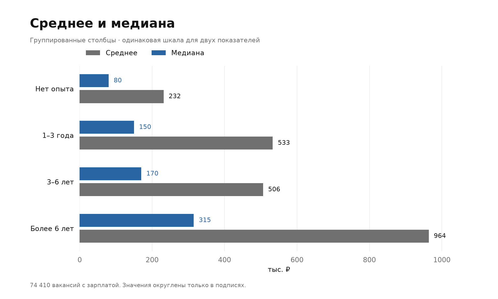

[PNG](salary-means-bars.png) · [SVG](salary-means-bars.svg)

### Соединённые точки, dumbbell

Удобно сравнить разрыв между двумя показателями.

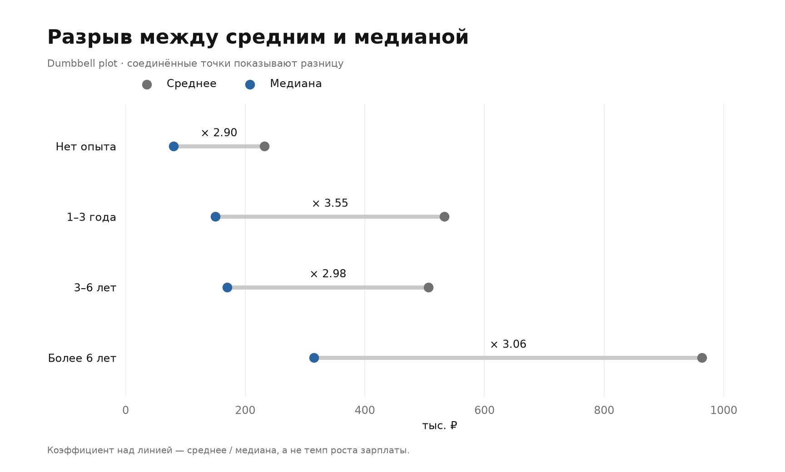

[PNG](salary-means-dumbbell.png) · [SVG](salary-means-dumbbell.svg)

### Авторские карточки

Подходят для короткого обзора; полосы имеют общую шкалу.

[PNG](salary-means-cards.png) · [SVG](salary-means-cards.svg)

## Разброс и центральный диапазон

Самый широкий абсолютный IQR — 165 тыс. ₽ в группе более 6 лет. Самый большой IQR относительно медианы — 71,7% в группе 1–3 года. Интервалы Q1–Q3 содержат центральные 50% наблюдений; это не доверительные интервалы.

### Разброс и центральный диапазон

Основной вариант.

[PNG](salary-quartiles-interval.png) · [SVG](salary-quartiles-interval.svg)

### Boxplot по исходным строкам

Показывает квартили, медиану и усы по правилу 1,5 IQR; выбросы скрыты только на рисунке.

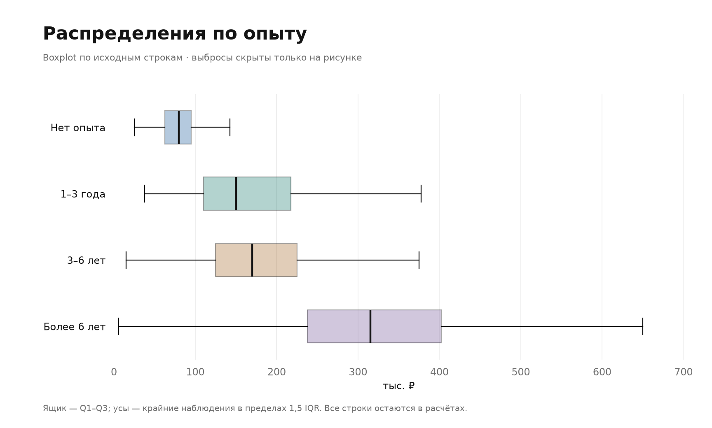

[PNG](salary-quartiles-boxplot.png) · [SVG](salary-quartiles-boxplot.svg)

### Авторская нормировка относительно медианы

Позволяет сравнить относительный разброс групп с разным уровнем зарплаты.

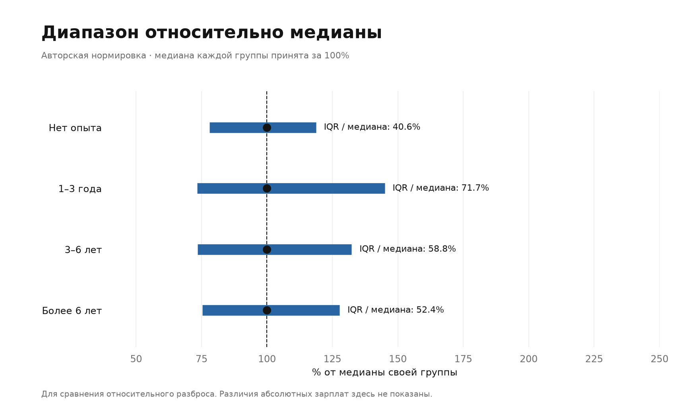

[PNG](salary-quartiles-normalized.png) · [SVG](salary-quartiles-normalized.svg)

## Сравнение городов

В группе 1–3 года медиана меняется от 95 тыс. ₽ в Нижнем Новгороде до 167,5 тыс. ₽ в Москве. Категорию опыта я фиксирую, чтобы сравнение городов было точнее. Состав профессий и тип занятости всё ещё могут влиять на разницу.

### Сравнение городов

Основной вариант.

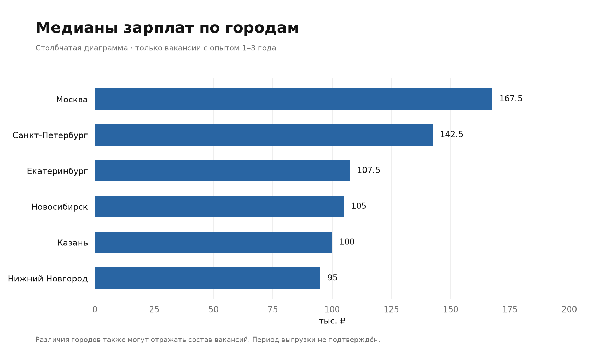

[PNG](salary-cities-bars.png) · [SVG](salary-cities-bars.svg)

### Точки и ориентир, lollipop

Сопоставляет города с медианой всей группы и показывает размер каждого сегмента.

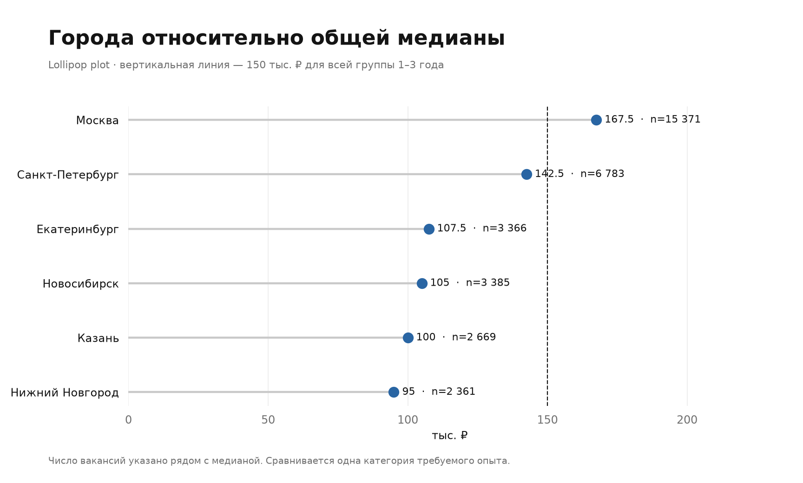

[PNG](salary-cities-lollipop.png) · [SVG](salary-cities-lollipop.svg)

### Матрица город × опыт

Добавляет второй разрез: медианы всех четырёх категорий опыта.

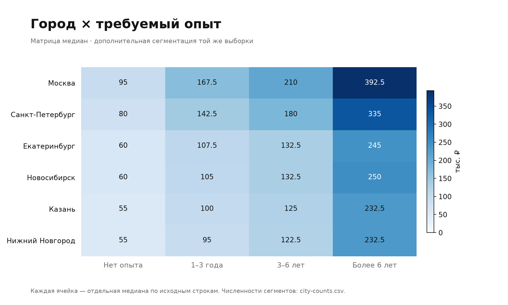

[PNG](salary-cities-matrix.png) · [SVG](salary-cities-matrix.svg)

## Форма распределений

На линейной гистограмме показана часть до 1 млн ₽, но доли рассчитаны от всей группы, а значения за пределами подписаны. Остальные варианты охватывают все наблюдения. Я не восстанавливал распределения по сводным числам — графики построены из исходных строк.

### Форма распределений

Основной вариант.

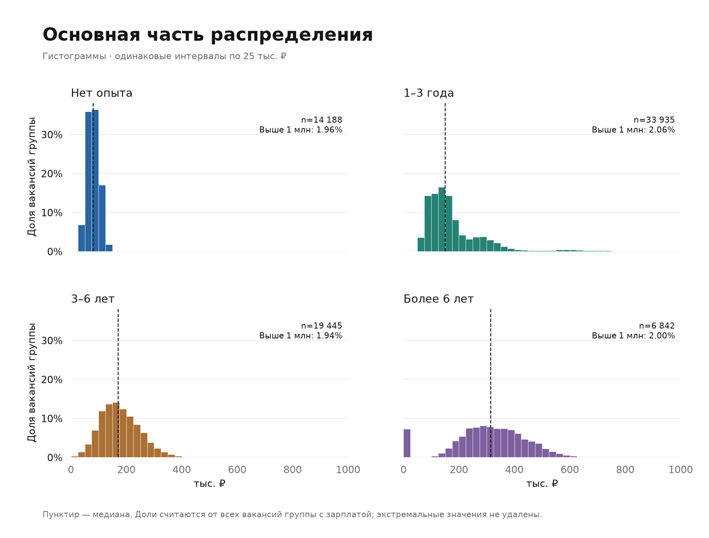

[PNG](salary-distribution-histogram.png) · [SVG](salary-distribution-histogram.svg)

### Полная гистограмма в логарифмах

Включает весь хвост; интервалы равны в логарифмах.

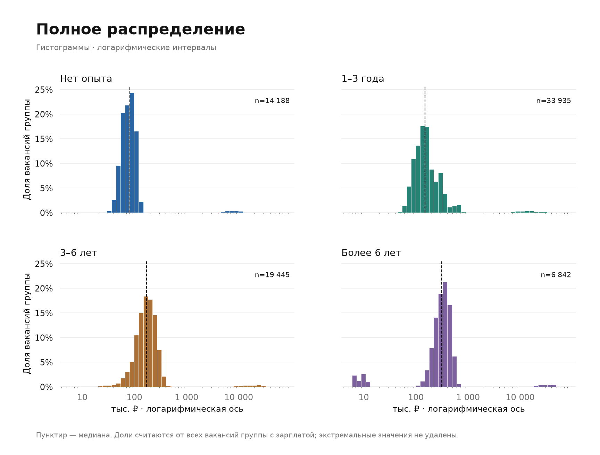

[PNG](salary-distribution-loghist.png) · [SVG](salary-distribution-loghist.svg)

### Накопленные распределения, ECDF

Отвечают на вопрос, какая доля вакансий ниже выбранного порога.

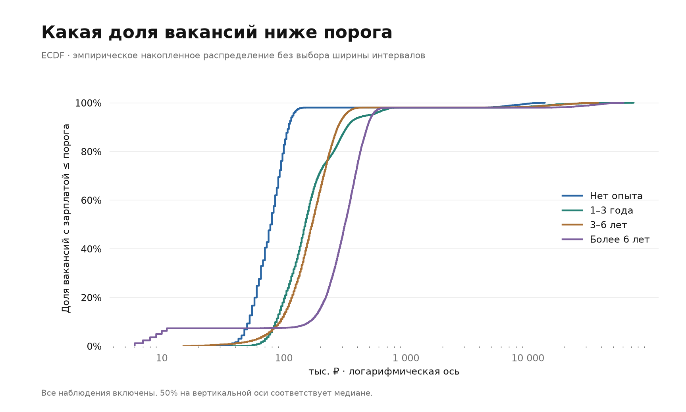

[PNG](salary-distribution-ecdf.png) · [SVG](salary-distribution-ecdf.svg)

### Violin plot в логарифмах

Сравнивает сглаженную форму распределений по всем наблюдениям.

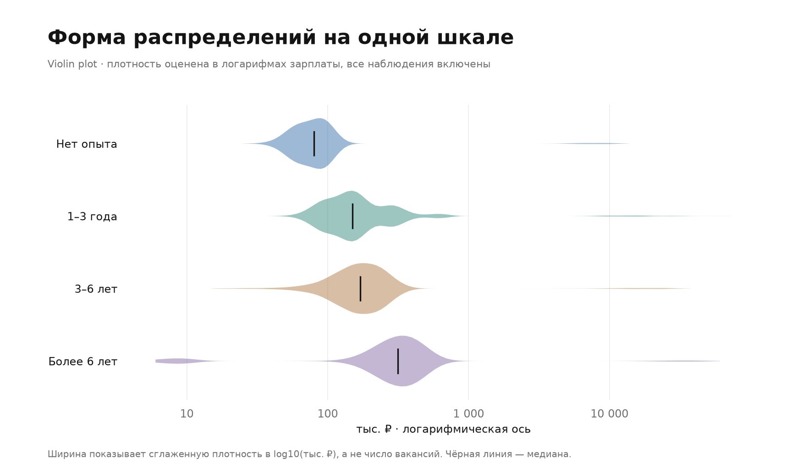

[PNG](salary-distribution-violin.png) · [SVG](salary-distribution-violin.svg)

### Авторские профили плотности

Выносят каждую группу на отдельную полосу; высота нормирована внутри группы.

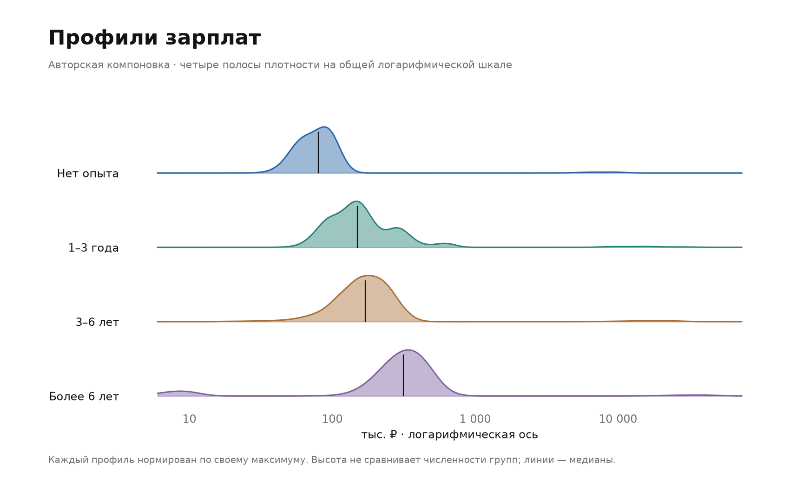

[PNG](salary-distribution-ridgeline.png) · [SVG](salary-distribution-ridgeline.svg)

## Полнота данных

Доля вакансий без зарплаты увеличивается от 5,2% в группе без опыта до 54,8% в группе более 6 лет. Сравниваемые зарплаты относятся только к записям, где зарплата указана. Это ограничение я учитываю при выводах. Данные: [data-quality.csv](data-quality.csv).

### Полнота данных

Основной вариант.

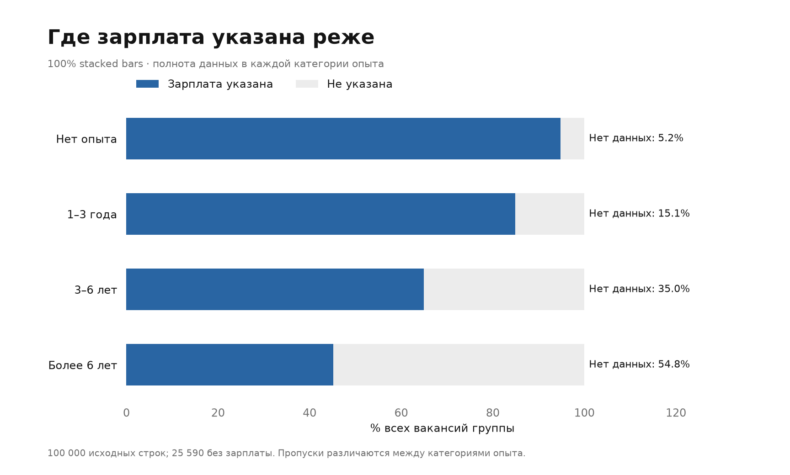

[PNG](salary-quality-missing.png) · [SVG](salary-quality-missing.svg)

### Точки: доля пропусков

Выделяют только отсутствующие зарплаты на общей шкале 0–100%.

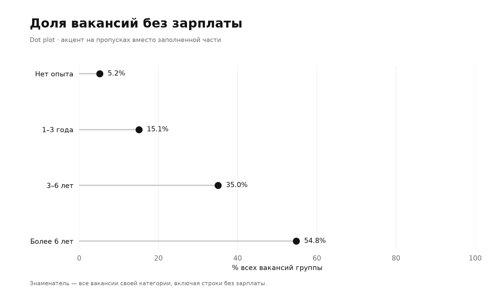

[PNG](salary-quality-dots.png) · [SVG](salary-quality-dots.svg)

### Авторские карточки полноты

Соединяют процент пропусков, их число и объём доступных данных.

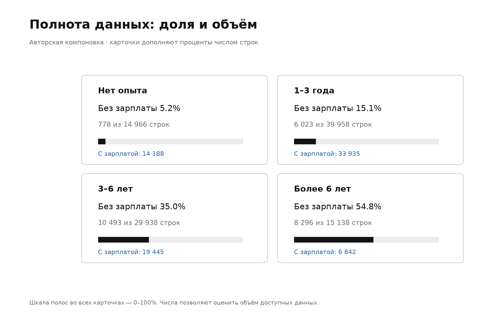

[PNG](salary-quality-cards.png) · [SVG](salary-quality-cards.svg)

