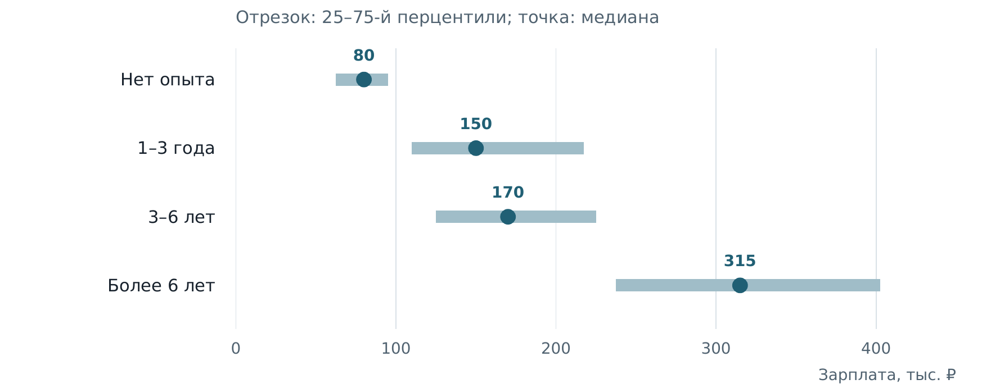
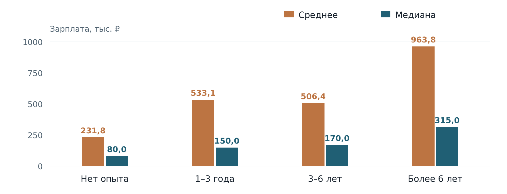
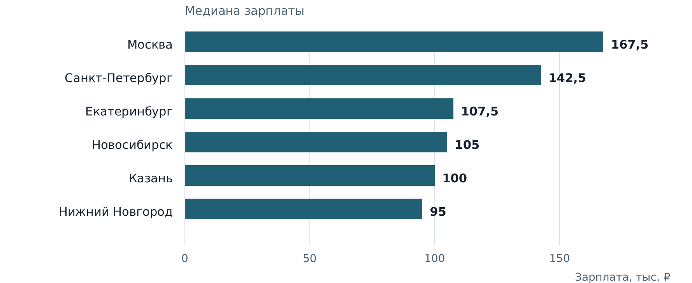

## Исследование зарплат в датасете вакансий

**Главный результат:** для вакансий с опытом 1–3 года медиана зарплаты — **150 000 ₽**, центральные 50% значений — **110 000–217 500 ₽**. Для сравнения предложений медиана и квартильный диапазон информативнее одного среднего.



### Что я хотел выяснить
Я разбирал датасет вакансий и хотел понять, какой показатель лучше описывает типичную зарплату и как предложения различаются по требуемому опыту. В зарплатную выборку вошли 74 410 вакансий.

### Что я сделал
- Извлекал сведения о зарплате, опыте и городе из датасета; группировал вакансии по четырём категориям опыта.
- Рассчитывал средние, медианы, стандартные отклонения и перцентили; сравнивал абсолютный и относительный разброс.
- Анализировал распределения на логарифмической шкале и объяснял влияние длинного правого хвоста.
- Формулировал выводы с учётом сегментации и качества исходных данных.

### Результаты
| Требуемый опыт | Вакансий | Среднее, ₽ | Медиана, ₽ | 25–75-й перцентили, ₽ |
|---|---:|---:|---:|---:|
| Нет опыта | 14 188 | 231 817 | 80 000 | 62 500–95 000 |
| 1–3 года | 33 935 | 533 136 | 150 000 | 110 000–217 500 |
| 3–6 лет | 19 445 | 506 372 | 170 000 | 125 000–225 000 |
| Более 6 лет | 6 842 | 963 834 | 315 000 | 237 500–402 500 |



Средние превышают медианы примерно в 2,9–3,6 раза. Наибольший абсолютный межквартильный размах — в группе более 6 лет: 165 000 ₽. Наибольший IQR относительно медианы — в группе 1–3 года: 71,7%.



В сохранённой разбивке по шести городам медианы различаются от 95 000 ₽ в Нижнем Новгороде до 167 500 ₽ в Москве. Эта разбивка представлена отдельно; принадлежность городских значений к конкретной группе опыта не установлена.

### На каких данных основаны выводы
Это учебное задание. От исходной работы у меня сохранились сводные показатели и гистограммы. Датасет и первоначальный код я пока не восстановил. Для портфолио добавил диаграммы и небольшой скрипт по сохранённым показателям: с ним можно повторить сводные расчёты.

Перед использованием этих цифр я бы проверил период выгрузки, профессии, валюты, период оплаты и дубли. Без исходных строк я не могу объяснить экстремальные зарплаты. Рост медиан по группам также не доказывает, что разница вызвана только опытом.

### Как повторить сводные расчёты
```bash
python analyze_summary.py
```
Используется стандартная библиотека Python. Данные: [salary-summary.csv](salary-summary.csv), [city-medians.csv](city-medians.csv). Скрипт проверяет объём выборки и рассчитывает IQR, отношение IQR к медиане и отношение среднего к медиане.

---

[← Все кейсы](https://github.com/antonislav11)
